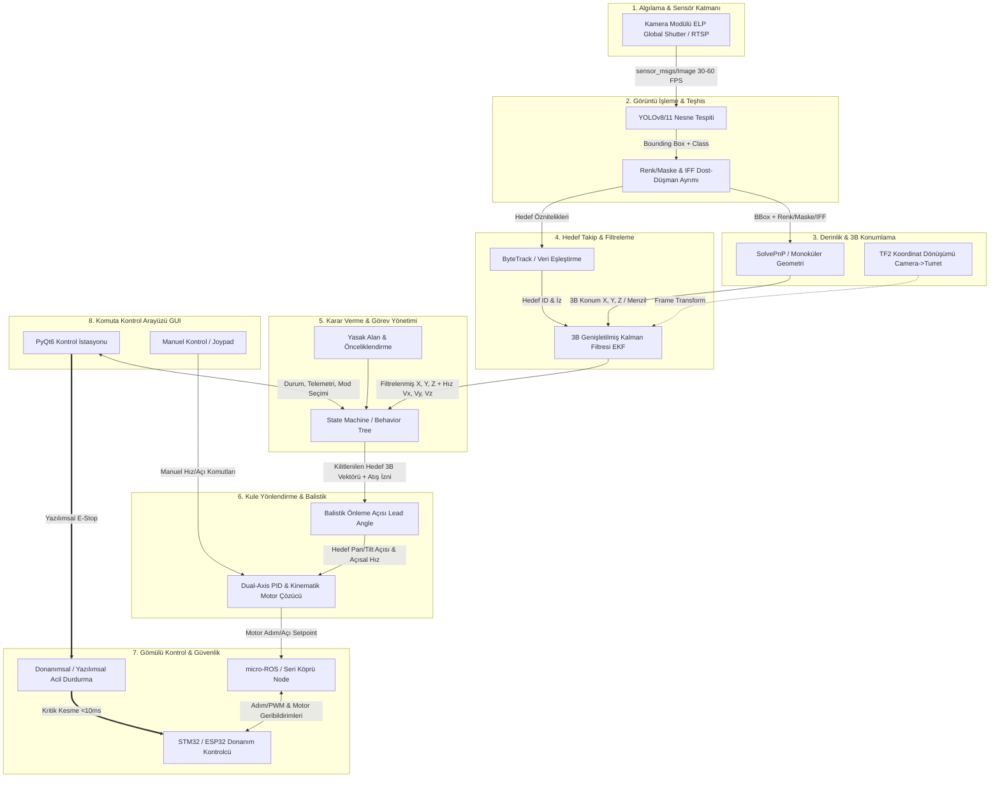

# Hava Savunma Sistemi (HSS) - Sistem Mühendisliği Mimarisi ve Çalışma Parçaları (WBS/PBS)

**Doküman Versiyonu:** 1.0  
**Tarih:** 2026-10-12  
**Kapsam:** TEKNOFEST Hava Savunma Sistemleri (HSS) Yarışması  
**Mühendislik Metodolojisi:** INCOSE Sistem Mühendisliği Yaşam Döngüsü (V-Model), Katmanlı Otonom Savunma Mimarisi  

---

## 1. Yönetici Özeti ve Sistem Mühendisliği Yaklaşımı

Bu doküman, kullanıcı tarafından belirlenen uçtan uca savunma zincirini (**Algılama ➔ 3B Konumlama ➔ Takip ➔ Karar/Görev ➔ Balistik/Kinematik ➔ Gömülü Kontrol ➔ Arayüz**) sistem mühendisliği standartlarına göre çalışma paketlerine (Work Breakdown Structure - WBS), ürün ağacına (Product Breakdown Structure - PBS) ve ROS 2 Humble mimarisine ayrıştırır.

Sistem; **Yüksek Güvenilirlik**, **Deterministik Tepki Süresi (<10 ms Acil Durdurma, <40 ms Görüntü-Tahrik Gecikmesi)** ve **Modülerlik** prensipleriyle tasarlanmıştır.



---

## 2. Çalışma Parçaları Ayrımı (WBS - Work Breakdown Structure)

Sistem mühendisliğinde karmaşık sistemler, bağımsız olarak geliştirilebilir, test edilebilir ve entegre edilebilir paketlere (WP - Work Packages) bölünür.

```
HSS_SYSTEM_WBS
│
├── WP-100: Sistem Entegrasyonu & Altyapı
│   ├── WP-110: ROS 2 Özel Mesaj/Servis/Aksiyon Arayüzleri (Interfaces)
│   ├── WP-120: Küresel Sistem Başlatma (Bringup & Launch Mimarisi)
│   └── WP-130: Sistem Parametreleri, QoS ve Ağ Yapılandırması
│
├── WP-200: Algılama & Görme Alt Sistemi (Perception & Vision)
│   ├── WP-210: Kamera Sürücüsü, Kalibrasyon & Image Pipeline
│   ├── WP-220: Derin Öğrenme Tabanlı Hedef Tespiti (YOLOv8/11)
│   └── WP-230: Renk Uzayı Segmentasyonu & Dost/Düşman Teşhisi (IFF)
│
├── WP-300: 3B Geometri & Durum Kestirimi (Estimation & Tracking)
│   ├── WP-310: Boyutsal Derinlik Kestirimi & SolvePnP Modülü
│   ├── WP-320: Koordinat Çerçeveleri & TF2 Ağacı (Kamera-Optik-Taret)
│   ├── WP-330: Çoklu Hedef Takibi (Data Association / ByteTrack)
│   └── WP-340: 3B Genişletilmiş Kalman Filtresi (EKF) & Hız Kestirimi
│
├── WP-400: Komuta Kontrol & Karar Yönetimi (Mission Management)
│   ├── WP-410: Aşama 1-2-3 Durum Makinesi (Finite State Machine / Behavior Tree)
│   ├── WP-420: Hedef Tehdit Puanlama & Önceliklendirme Matrisi
│   └── WP-430: Yasak Alan (No-Fire Zone) & Angajman Güvenlik Filtresi
│
├── WP-500: Atış Kontrol & Kinematik (Fire Control & Kinematics)
│   ├── WP-510: Dinamik Hedef Önleme Açısı (Lead Angle / Intercept Calculation)
│   ├── WP-520: Çift Eksenli (Pan/Tilt) Dual-Axis PID Kontrolcü
│   └── WP-530: Ters Kinematik & Adım/Hız Dönüştürücü
│
├── WP-600: Donanım Sürücü & Emniyet Katmanı (Embedded Bridge & Safety)
│   ├── WP-610: PC-Mikrodenetleyici Haberleşme Köprüsü (micro-ROS / UART)
│   ├── WP-620: STM32/ESP32 Gömülü Yazılımı (Timer, Step/Dir, AccelStepper)
│   ├── WP-630: Güvenlik, Limit Switch & Donanımsal Watchdog/E-Stop
│   └── WP-640: Lazer / Mühimmat Tetikleme & Atış Geri Bildirimi
│
├── WP-700: Komuta Kontrol Arayüzü & HMI (Ground Control Station)
│   ├── WP-710: Canlı HUD Video Akışı & Hedef Bindirmeleri (Overlays)
│   ├── WP-720: Telemetri, Hata Teşhis & Mod Yönetim Paneli
│   └── WP-730: Manuel Kontrol (Gamepad / Sanal Joystick) Entegrasyonu
│
└── WP-800: Simülasyon, Doğrulama & Test (V&V - Verification & Validation)
    ├── WP-810: Gazebo / RViz2 Sentetik Hedef Simülasyonu
    ├── WP-820: MIL/SIL (Model/Software-in-the-Loop) Test Senaryoları
    └── WP-830: Rosbag2 Kayıt & Uçtan Uca Gecikme Analiz Altyapısı
```

---

## 3. Hedef ROS 2 Workspace Klasör Mimarisi

Şu anki tekdüze veya karışık yapıyı sistem mühendisliği ayrımıyla aşağıdaki modüler paket yapısına kavuşturuyoruz:

```text
hss_ws/
├── src/
│   ├── hss_interfaces/                     # Ortak Mesaj, Servis ve Aksiyon Paketleri
│   │   ├── msg/
│   │   │   ├── Detection2D.msg            # Bounding box, sınıf, güven skoru, renk
│   │   │   ├── Detection2DArray.msg       # Tek karedeki tüm tespitler
│   │   │   ├── Target3D.msg               # 3B konum (X,Y,Z), mesafe, koordinat çerçevesi
│   │   │   ├── TrackedTarget.msg          # ID, filtrelenmiş 3B konum, hız vektörü (Vx,Vy,Vz)
│   │   │   ├── TrackedTargetArray.msg     # Aktif takip edilen hedefler
│   │   │   ├── FireControlCommand.msg     # Balistik açı, tetik emri, kilit durumu
│   │   │   ├── MotorSetpoint.msg          # Pan/Tilt hedef açı, adım sayısı, hız
│   │   │   └── MotorFeedback.msg          # Enkoder, güncel adım, limit switch durumu
│   │   ├── srv/
│   │   │   ├── SetMissionPhase.srv        # Aşama 1, 2, 3 seçim servisi
│   │   │   ├── SetNoFireZone.srv          # Yasaklı açı/alan koordinat kaydı
│   │   │   └── TriggerFire.srv            # Manuel atış tetikleme
│   │   └── action/
│   │       └── EngageTarget.action        # Hedefe kilitlenme, takip ve imha yaşam döngüsü
│   │
│   ├── hss_sensing/                        # Kamera ve Sensör Sürücüleri
│   │   ├── hss_sensing/
│   │   │   ├── camera_driver_node.py      # Global shutter USB/CSI/RTSP sürücüsü (Zero-copy / Low latency)
│   │   │   └── camera_calibration.py      # Kamera intrinsics (K, D matrisleri) okuyucu
│   │   └── config/
│   │       └── camera_params.yaml         # Kamera çözünürlük, pozlama, FPS ayarları
│   │
│   ├── hss_perception/                     # Algılama & Görüntü İşleme Katmanı
│   │   ├── hss_perception/
│   │   │   ├── detector_node.py           # YOLOv8/11 Inference Node (TensorRT / ONNX / PyTorch)
│   │   │   ├── color_classifier.py        # HSV/Lab uzayında Dost/Düşman (Mavi/Kırmızı) ayrımı
│   │   │   └── balloon_segmenter.py       # İHA altındaki balon/faydalı yük tespiti
│   │   ├── models/
│   │   │   └── hss_yolo_weights.engine    # TensorRT optimize edilmiş model ağırlıkları
│   │   └── config/
│   │       └── perception_params.yaml     # Eşik değerler, IFF renk aralıkları
│   │
│   ├── hss_localization_3d/                # Derinlik & 3B Konumlama Katmanı
│   │   ├── hss_localization_3d/
│   │   │   ├── pnp_depth_estimator.py     # Hedef CAD boyutlarına göre solvePnP ile 3B poz tahmini
│   │   │   ├── focal_depth_estimator.py   # Dikey boyut benzerliğinden hızlı mesafe tahmini
│   │   │   └── tf_broadcaster_node.py     # optical_frame -> camera_link -> turret_base TF yayınları
│   │   └── config/
│   │       └── target_dimensions.yaml     # İHA, Balon, F16 gerçek dünya boyut matrisi
│   │
│   ├── hss_tracking/                       # Hedef Takip & Filtreleme (Kalman)
│   │   ├── hss_tracking/
│   │   │   ├── tracker_node.py            # ByteTrack çoklu hedef eşleme ve ID yönetimi
│   │   │   └── ekf_filter_3d.py           # Sabit İvmeli / Sabit Hızlı 3B Kalman Filtresi
│   │   └── config/
│   │       └── tracker_params.yaml        # Kalman kovaryans matrisleri (Q, R), kayıp hedef zaman aşımı
│   │
│   ├── hss_mission_control/                # Karar Verme & Görev Yönetimi
│   │   ├── hss_mission_control/
│   │   │   ├── mission_fsm_node.py        # Durum Makinesi (BEKLE, TARA, KİLİTLEN, İMHA, COASTING)
│   │   │   ├── threat_evaluator.py        # Hedef önceliklendirme ve tehdit skoru hesabı
│   │   │   └── safety_guard.py            # Yasak bölge (NFZ) denetimi, Atış İzni mantığı
│   │   └── config/
│   │       └── mission_params.yaml        # Angajman mesafeleri, süre sınırları, ceza kuralları
│   │
│   ├── hss_guidance_control/               # Silah/Kule Yönlendirme & Kinematik
│   │   ├── hss_guidance_control/
│   │   │   ├── ballistic_calculator.py    # Hedef hızına göre Lead Angle (Önleme Atışı) kestirimi
│   │   │   ├── dual_axis_pid_node.py      # Pan & Tilt PID kapalı çevrim kontrolcü
│   │   │   └── kinematic_solver.py        # Taret mekanik limitleri ve derece-adım çevrimi
│   │   └── config/
│   │       └── control_params.yaml        # Kp, Ki, Kd, Deadband, Feedforward katsayıları
│   │
│   ├── hss_hardware_bridge/                # Gömülü Kontrol & Güvenlik Köprüsü
│   │   ├── hss_hardware_bridge/
│   │   │   ├── serial_bridge_node.py      # micro-ROS Agent veya Yüksek hızlı UART binary köprü
│   │   │   └── hardware_watchdog.py       # E-Stop denetimi, kalp atışı (heartbeat) monitörü
│   │   ├── firmware/                      # STM32 / ESP32 PlatformIO / Keil projeleri
│   │   │   ├── main.cpp                   # micro-ROS client veya binary parser
│   │   │   └── motor_stepper_drv.c        # Timer kesmeleriyle titremesiz step sürüşü
│   │   └── config/
│   │       └── hardware_params.yaml       # Port (/dev/ttyUSB0), baudrate, limit switch pinleri
│   │
│   ├── hss_gui/                            # Komuta Kontrol Arayüzü (Yer İstasyonu)
│   │   ├── hss_gui/
│   │   │   ├── main_window.py             # PyQt6 Glassmorphism savunma sanayii arayüzü
│   │   │   ├── video_overlay.py           # HUD yapay ufuk, hedef nişangahı ve bilgi kartları
│   │   │   └── telemetry_panel.py         # Anlık grafikler, motor açıları ve durum logları
│   │   └── resources/
│   │       └── style.qss                  # QSS tema ve karanlık mod şablonu
│   │
│   ├── hss_bringup/                        # Küresel Başlatma (Launch) & Entegrasyon
│   │   ├── launch/
│   │   │   ├── hss_full_system.launch.py  # Tüm donanım ve düğümleri tek tıkla başlatan dosya
│   │   │   ├── hss_vision_only.launch.py  # Yalnızca kamera ve algılamayı test etme launch'ı
│   │   │   └── hss_sim.launch.py          # Simülasyon ortamı başlatma
│   │   └── rviz/
│   │       └── hss_view.rviz              # 3B takip ve TF görselleştirme profili
│   │
│   └── hss_sim/                            # Gazebo Simülasyon Ortamı
│       ├── urdf/
│       │   └── hss_turret.urdf.xacro      # Pan-Tilt taret mekanik modeli
│       ├── worlds/
│       │   └── teknofest_arena.world      # Hedef uçuş rotaları ve poligon dünyası
│       └── models/
│           └── target_drone/              # Döner kanat ve sabit kanat simülasyon hedefleri
```

---

## 4. Arayüz Kontrol Dokümanı (ICD - Interface Control Document)

Sistem parçalarının birbiriyle konuşma protokolleri, mesaj tipleri ve deterministik gecikme bütçeleri aşağıdaki matriste standartlaştırılmıştır:

| Arayüz / Veri Hattı | Kaynak Düğüm | Hedef Düğüm | ROS 2 Türü | Mesaj / Servis Adı | Frekans / Bütçe | Açıklama |
| :--- | :--- | :--- | :--- | :--- | :--- | :--- |
| **Kamera Akışı** | `camera_driver_node` | `detector_node` & `gui` | Topic | `sensor_msgs/Image` | 30 - 60 Hz (<15 ms) | Zero-copy veya paylaşımlı bellek (loaned message) ile sıfır gecikmeli video akışı. |
| **Ham Tespitler** | `detector_node` | `pnp_depth_estimator` | Topic | `hss_interfaces/Detection2DArray` | 30 Hz (<30 ms) | YOLOv8/11 Bounding Box (x,y,w,h), Sınıf, Güven ve IFF rengi. |
| **3B Konumlar** | `pnp_depth_estimator` | `tracker_node` | Topic | `hss_interfaces/Target3D` | 30 Hz (<5 ms) | Kameraya göre ve TF dönüşümlü taret merkezine göre X, Y, Z (metre) pozisyonu. |
| **Filtrelenmiş İzler** | `tracker_node` | `mission_fsm_node` | Topic | `hss_interfaces/TrackedTargetArray`| 30 - 50 Hz (<2 ms) | Kalman filtresi çıkışı: Titreşimsiz X, Y, Z ve türetilmiş hız vektörleri (Vx, Vy, Vz). |
| **Angaje Hedef** | `mission_fsm_node` | `ballistic_calculator` | Topic | `hss_interfaces/TrackedTarget` | 50 Hz (<2 ms) | Durum makinesinin önceliklendirip kilitlenme kararı verdiği tekil hedef bilgisi. |
| **Atış/Önleme Emri** | `ballistic_calculator`| `dual_axis_pid_node` | Topic | `hss_interfaces/FireControlCommand` | 50 Hz (<5 ms) | Hedefin gelecekteki konumuna göre hesaplanan Pan/Tilt açısı ve ateşleme izni bayrağı. |
| **Motor Komutu** | `dual_axis_pid_node` | `serial_bridge_node` | Topic | `hss_interfaces/MotorSetpoint` | 50 - 100 Hz (<2 ms)| Eksen bazında hedef açı (derece), adım sayısı ve maksimum açısal hız. |
| **Motor Geri Bildirim**| `serial_bridge_node` | `dual_axis_pid` & `gui` | Topic | `hss_interfaces/MotorFeedback` | 50 - 100 Hz (<5 ms)| MCU'dan gelen anlık eksen açıları, tork/adım durumu, limit sensörleri. |
| **Acil Durdurma (E-Stop)**| `gui` / `watchdog` | `serial_bridge_node` & `MCU`| Topic | `std_msgs/Bool` | Event (<10 ms Kesme)| Güvenlik hattı: En yüksek öncelikli QoS (Reliable + Transient Local) ile motor elektriğini kesme emri. |
| **Aşama Seçimi** | `gui` | `mission_fsm_node` | Service | `hss_interfaces/SetMissionPhase` | Asenkron Çağrı | Yarışma Aşama 1, Aşama 2 veya Aşama 3 kurallarının ve algoritmalarının devreye alınması. |
| **Hedefe Angaje Ol** | `gui` / Otonom | `mission_fsm_node` | Action | `hss_interfaces/EngageTarget` | Geri bildirimli | Kilitlenme, takip süresi sayımı (örn. 3 sn kesintisiz takip kuralı) ve imha tamamlandı bildirimi. |

---

## 5. Sistem Mühendisliği Katman Detayları ve Bağımlılıklar

### Katman 1: Algılama & Görüntü İşleme (Perception & IFF)
- **Giriş:** Ham video çerçevesi (`sensor_msgs/Image`).
- **Çekirdek Algoritma:**
  - YOLOv8/11 (Ultralytics) ile nesne sınıflandırma (`Drone`, `Balon`, `Uçak`).
  - HSV/CIE-Lab renk uzayında sınır kutusu içi adaptif histogram maskeleme (Dost = Mavi, Düşman = Kırmızı/Turuncu).
  - İHA altındaki yükün (balon) ikincil tespit kutusunun hiyerarşik ilişkilendirilmesi.
- **Yazılım Bağımlılıkları:** `ultralytics`, `opencv-python`, `torch`, `cv_bridge`, `cuda` (Jetson/GPU varsa).
- **Donanım:** ELP Global Shutter USB Kamera (M12 Geniş Açı Lens, AR0144 sensör).

### Katman 2: Derinlik & 3B Konumlama (Localization 3D)
- **Giriş:** 2B Bounding Box (`Detection2D`), hedef sınıfı.
- **Çekirdek Algoritma:**
  - **Mono PnP (Perspective-n-Point):** Hedef sınıfının bilinen gerçek boyutları (CAD ölçüleri) ile görüntüdeki 2B köşe noktaları eşleştirilerek OpenCV `solvePnP` ile 6-DoF dönüşüm matrisi $[R | T]$ elde edilir. $T_z$ doğrudan hedefin radyal mesafesidir.
  - **Dikey Geometri Benzerliği:** Hedefin dönüş açısından bağımsız olan dikey yüksekliği referans alınarak $Z = \frac{f \cdot H_{real}}{h_{pixel}}$ bağıntısıyla hızlı mesafe doğrulaması.
  - **TF2 Çerçevesi:** `camera_optical_frame` koordinatları, mekanik offset matrisi ile `turret_pitch_axis` ve `turret_base_link` çerçevelerine dönüştürülür.
- **Yazılım Bağımlılıkları:** `numpy`, `scipy`, `tf2_ros`, `geometry_msgs`.

### Katman 3: Hedef Takip & Filtreleme (Tracking & State Estimation)
- **Giriş:** 3B hedefler (`Target3D`).
- **Çekirdek Algoritma:**
  - **ByteTrack / SORT:** Birden fazla hedef tespit edildiğinde Mahalanobis mesafesi ve Kalman kestirimi ile her hedefe benzersiz ve kalıcı bir `Track ID` atanması.
  - **3B EKF (Extended Kalman Filter):** Konum ölçümlerindeki gürültüyü (titremeyi) temizler. Durum vektörü: $X = [x, y, z, \dot{x}, \dot{y}, \dot{z}]^T$. Hız bileşenlerini $(\dot{x}, \dot{y}, \dot{z})$ dinamik olarak türetir.
  - **Coasting (Kestirim Modu):** Hedef ağaç/engel arkasına girdiğinde veya 1 saniyeye kadar görüntüden kaybolduğunda, son bilinen hız vektörüyle hedefin sanal konumunu tahmin ederek taretin hedefin çıkacağı yöne dönmeye devam etmesini sağlar.
- **Yazılım Bağımlılıkları:** `filterpy` veya özgün C++/Python Kalman implementasyonu.

### Katman 4: Karar Verme & Görev Yönetimi (C2 - Command & Control)
- **Giriş:** Takip edilen izler (`TrackedTargetArray`), Operatör modları, Aşama konfigürasyonu.
- **Çekirdek Algoritma:**
  - **Durum Makinesi (Finite State Machine):**
    - `BEKLE`: Sistem hazır, motorlar kalibre.
    - `TARAMA_MODU`: Hedef yoksa belirli sektörler taranır (S-pattern arama).
    - `HEDEF_TESPIT`: Hedef belirdi, IFF kontrolü yapıldı (Dost ise angajman reddedilir).
    - `HEDEF_TAKIP_VE_NISAN`: Hedef merkeze alındı, PID ile kilit sağlandı.
    - `IMHA_SAYACI`: Şartnamedeki "X saniye hedefe kilitli kalma" süresi sayılır.
    - `ATESLE`: Lazer/tetik sinyali üretilir.
    - `GÜVENLİ_DURMA`: E-Stop veya arıza durumu.
  - **Tehdit Değerlendirmesi:** Mesafe, yaklaşma hızı ve hedefin merkeze uzaklığına göre ağırlıklı önceliklendirme.
  - **Yasak Alan Denetimi (No-Fire Zone):** Taret açısı önceden belirlenen açı kısıtları içindeyse atış kilidi devre dışı bırakılır.
- **Yazılım Bağımlılıkları:** `transitions` kütüphanesi veya ROS 2 `BehaviorTree.CPP` / native Python FSM.

### Katman 5: Silah / Kule Yönlendirme (Guidance & Control)
- **Giriş:** Kilitlenilen hedef 3B koordinatı ve hız vektörü.
- **Çekirdek Algoritma:**
  - **Balistik & Önleme Açısı (Lead Angle):** Hedef hareketliyken (Aşama 2), hedefin mevcut konumuna değil; lazerin/mühimmatın varış süresi $t_{flight} = \frac{R}{V_{projectile}}$ kadar gelecekteki konuma $\vec{P}_{intercept} = \vec{P}_0 + \vec{V} \cdot t_{flight}$ nişan alınır.
  - **Dual-Axis PID:** Pan ve Tilt eksenleri için bağımsız $K_p, K_i, K_d$ hesabı, Anti-Windup saturasyonu ve motor titremesini önleyen deadband filtresi.
  - **Kinematik Motor Hesaplayıcı:** Açısal hatadan motor adımına (steps/degree) dönüşüm.
- **Yazılım Bağımlılıkları:** Özgün Python PID kütüphanesi (`DualAxisPIDController`).

### Katman 6: Gömülü Kontrol & Güvenlik (Embedded Bridge & Safety)
- **Giriş:** Motor Setpoint mesajları.
- **Çekirdek Algoritma:**
  - **micro-ROS / Serial Driver:** PC ile STM32/ESP32 arasında 115200 veya 921600 baud hızında çift yönlü haberleşme.
  - **Donanımsal Timer Kesmesi:** Step motor sürücülerine (TB6600 / TMC2209) mikrosaniye hassasiyetinde `PUL` ve `DIR` palsleri üretimi.
  - **Donanımsal Emniyet (Heartbeat / Watchdog):** PC'den 100 ms boyunca kalp atışı gelmezse MCU tüm motor çıkışlarını derhal kapatır.
- **Donanım:** STM32F4 / ESP32, TB6600 Sürücüler, NEMA 17/23 Step Motorlar, Limit Switchler, Endüstriyel E-Stop Butonu.

### Katman 7: Kullanıcı Arayüzü & Telemetri (HMI / GUI)
- **Giriş/Çıkış:** Tüm telemetri topic'leri, operatör butonları, canlı video.
- **Çekirdek Algoritma:**
  - PyQt6 tabanlı, QThread ile GUI iş parçacığından izole ROS 2 spini.
  - Video üzerinde gerçek zamanlı yapay ufuk, hedef nişangahı (Crosshair), telemetri overlay'leri.
  - Manuel modda USB Gamepad / Joystick okuma ve taret yönlendirme.
- **Yazılım Bağımlılıkları:** `PyQt6`, `qdarktheme` / özel CSS.

---

## 6. Emniyet ve Hata Modları Analizi (FMEA - Failure Mode and Effects Analysis)

| Hata Senaryosu | Etki | Sistem Mühendisliği Çözümü & Emniyet Aksiyonu |
| :--- | :--- | :--- |
| **Kamera Akışının Kopması** | Hedef körlüğü, kontrol kaybı | Kamera düğümü `heartbeat` yayınlar; 3 kare veri gelmezse FSM derhal `BEKLEME` moduna geçer ve motorlar durdurulur. |
| **Hedefin Görüşten Çıkması** | PID diverjansı / Takip kaybı | `Coasting` modu 1.0 saniye boyunca son bilinen yönde tahmini sürdürür; ardından hedefin tekrar bulunması için `TARAMA_MODU` devreye girer. |
| **Hatalı Hedefe Ateş Etme** | 5 Ceza Puanı (Şartname kuralı) | FSM katmanında sıkı çift doğrulamalı IFF (Renk + ID) filtresi. Doğrulanmayan hiçbir hedefe ateşleme yetkisi verilmez. |
| **PC ile MCU İletişiminin Kopması** | Motorların kontrolsüz dönmesi | MCU donanımsal Watchdog Timer (WDT) 50 ms içinde tetiklenerek motor sürücü enable pinini `LOW` yapar. |
| **Fiziksel Mekanik Sıkışma / Limit Aşımı**| Motor yanması, mekanik hasar | Donanımsal optik/mekanik limit switchler doğrudan MCU harici kesme (EXTI) pinlerine bağlıdır; yazılımdan bağımsız torku keser. |
| **Operatör Acil Durdurması (E-Stop)** | İnsan/Çevre güvenliği | Donanımsal E-stop doğrudan güç rölesini açar (<1 ms); arayüz E-stop ise ROS 2 üzerinden en yüksek öncelikle motor komutlarını sıfırlar. |

---

## 7. Doğrulama ve Geçerleme (V&V) Yol Haritası

Sistem mühendisliğinde geliştirme Fazlar (Milestones) halinde ilerletilir:

```
[FAZ 1: Sensör ve Temel Algılama Doğrulaması]
 ├── Kamera sürücüsü 30 FPS kararlılık testi
 ├── YOLOv8 hedef tespit doğruluğu (mAP > 0.85) ve IFF renk ayrımı
 └── Motorların açık çevrim adım ve açı hassasiyeti kalibrasyonu

[FAZ 2: Statik Angajman & Takip (Aşama 1 Uyumu)]
 ├── Dual-Axis PID ile hedef merkezleme ve piksel-açı eşlemesi
 ├── FSM ile otomatik arama, kilitlenme ve atış simülasyonu
 └── PyQt6 arayüzü ile tam telemetri ve video HUD entegrasyonu

[FAZ 3: Dinamik Hedef Takibi & Balistik Önleme (Aşama 2 Uyumu)]
 ├── SolvePnP / Derinlik kestirimi ile 3B konum çıkarımı
 ├── ByteTrack ve 3B Kalman Filtresi ile gürültü temizleme ve hız kestirimi
 └── Balistik Lead Angle algoritması ile hareketli hedefin önüne nişan alma

[FAZ 4: Entegre Sistem & Saha/Yarışma Testi (Aşama 3 & Final)]
 ├── Gazebo ve gerçek poligonda sürü hedef / çoklu hedef senaryoları
 ├── Uçtan uca gecikme analizi (Kamera fotonu -> Motor adımı < 40 ms)
 └── E-Stop, Yasak Alan ve Hata Güvenlik (Fail-Safe) stres testleri
```
